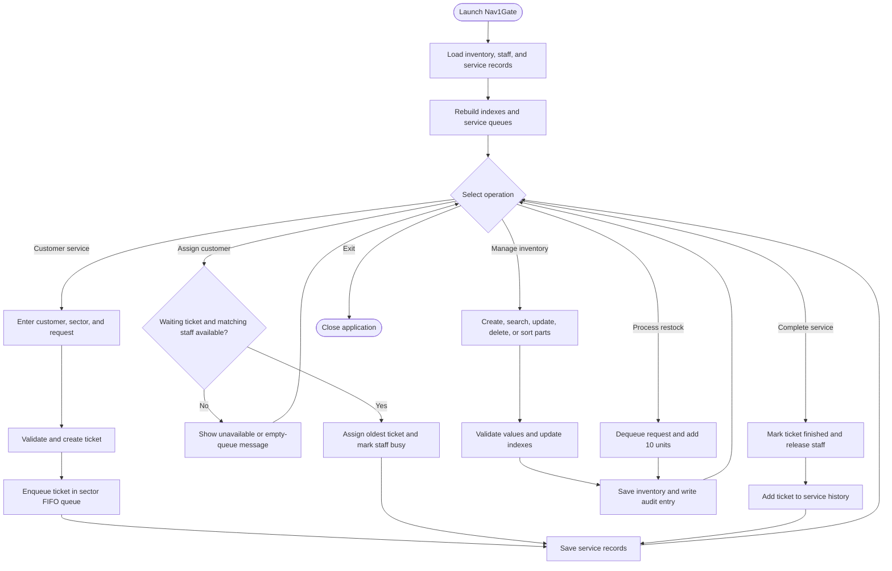

# PROJECT DOCUMENTATION: Nav1Gate

## 1. Project Title

**Nav1Gate: Customer Service Routing and PC-Parts Inventory Management**

Nav1Gate is a desktop application for managing customer service requests,
staff assignments, service history, and PC-parts inventory in a computer store.

## 2. Problem Statement

Computer-parts stores handle both product sales and customer support. Customers
may need help with retail purchases, PC assembly, hardware repair, or software
repair. Without a shared tracking process, customer requests can be difficult
to route, staff availability can be unclear, and inventory information can be
hard to maintain.

Customers, service staff, and store operators experience these coordination
problems. A software solution is useful because it organizes requests by
service sector, preserves the order of waiting customers, shows staff
availability, and keeps service and inventory records available after the
application is restarted.

## 3. Project Objectives

Nav1Gate intends to:

1. Register customers for Assembly, Retail, Hardware Repair, Software Repair,
   or General Service.
2. Maintain a first-in, first-out (FIFO) waitlist for each sector.
3. Assign the oldest waiting customer to available staff from the same sector.
4. Track active and completed service tickets and maintain service history.
5. Add, update, and remove staff while preventing removal of busy staff.
6. Create, search, update, sort, and delete PC-parts inventory records.
7. Queue restock requests and increase stock when a request is processed.
8. Demonstrate data structures and algorithms through working application
   features and tests.

## 4. System Overview

When launched, Nav1Gate loads inventory, staff, and service tickets from
per-user JSON files and rebuilds its in-memory indexes and queues. The Tkinter
interface opens by default; the command-line menu is available with
`python main.py --cli`.

For customer service, the operator enters a customer's name, service sector,
and request. The system creates a ticket and adds it to that sector's waitlist.
When an eligible staff member is available, the operator assigns the next
ticket. The system marks the ticket active and the staff member busy. On
completion, it marks the ticket finished, releases the staff member, and adds
the ticket to service history.

For inventory, the operator can create, inspect, edit, delete, search, and sort
PC parts. The system derives a restock warning when a product has five or fewer
units. Restock requests enter a queue; processing a request adds ten units to
the corresponding product.

Inventory is stored in `inventory.json`; staff and service tickets are stored
in `services.json`; application actions are appended to `audit.log`. These
records persist across restarts. The inventory undo stack and restock queue are
in-memory only.

## 5. Data Structure Used

| Structure | Where it is used | Why it is appropriate |
|---|---|---|
| ArrayList | Primary product, staff, ticket, and active-customer collections | Supports ordered collections and iteration in the GUI and business logic. |
| Queue | Per-sector customer waitlists and restock requests | FIFO behavior ensures the earliest waiting customer or restock request is processed first. |
| Stack | Inventory undo history and service tracking | Provides last-in, first-out operations for undo and service record workflows. |
| Linked list | Completed-service history and recently viewed products | Stores sequential records and supports traversal in order. |
| Hash table | Product-by-SKU, staff-by-ID, and ticket-by-ID indexes | Provides direct identifier-based lookup; collisions use separate chaining. |
| Binary search tree | Price index for products | Organizes products by price and demonstrates tree insertion and lookup operations. |
| Set | Supported service sectors and unique product categories | Maintains unique values without duplicates. |

These structures are implemented in `data_structures.py` and coordinated by
`InventorySystem` in `app.py`. The ArrayList uses Python's list internally;
the queue uses a deque.

## 6. Algorithms Used

- **Linear search:** scans products to find a name or category containing the
  search text. Its time complexity is O(n).
- **Merge sort:** orders inventory by name or price and prepares SKU records
  for binary search. Its time complexity is O(n log n).
- **Binary search:** locates an exact SKU in sorted product data. Binary
  search is O(log n) after sorting; because the current SKU lookup sorts for
  each search, the complete operation is O(n log n).
- **Nearest-price search:** sorts products by price and recursively narrows
  the search range to find the closest value. The complete operation is
  O(n log n), including sorting.
- **FIFO queue operations:** add tickets at the back of a sector queue and
  assign from its front, preserving arrival order.

The price tree is maintained as an index, while the user-facing sort and
nearest-price operations use merge sort.

## 7. System Flow



## 8. Implementation

The application separates the graphical interface (`gui.py`) from the
business rules (`app.py`). Data records and persistence helpers are defined in
`inventory.py`; reusable structures and algorithms are in
`data_structures.py` and `algorithms.py`.

The assignment operation dequeues the oldest sector ticket only after
confirming that appropriate staff are available. Its core state changes are:

```python
ticket = queue.dequeue()
ticket.status = "Active"
ticket.staff_id = staff_member.staff_id
staff_member.available = False
self.active_stack.push(ticket)
self.active_tickets.append(ticket)
self.save_services()
```

This transition connects the FIFO waitlist to staff availability and saves the
updated service state.

Inventory creation validates the SKU and numeric values, updates the
collections and indexes, and persists the new product:

```python
product = Product(sku, name.strip(), category.strip(), quantity, price)
product.update_status()
self._index_product(product)
self.history.push(("create", sku, None))
self.save()
```

In the full implementation, validation occurs before this excerpt: duplicate
SKUs, negative quantities or prices, fractional quantities, and non-finite
prices are rejected. Product status is set to **Restock needed** when quantity
is five or fewer.

## 9. Testing

The automated tests use Python's `unittest` framework and temporary
directories for persistence cases. Run them with:

```text
python -m unittest -v test_app.py
```

| Test area | Expected result | Result in project test report |
|---|---|---|
| Inventory CRUD and persistence | Products can be created, read, updated, deleted, and reloaded | Pass |
| Input validation | Duplicate, negative, fractional, and non-finite values are rejected | Pass |
| Data structures | Queue, stack, linked list, hash table, and tree operations behave correctly | Pass |
| Search and sorting | Linear search, binary search, merge sort, and nearest-price lookup return expected results | Pass |
| Customer service lifecycle | Tickets enter a waitlist, are assigned, and can be completed | Pass |
| Staff rules | Availability changes with service; busy staff cannot be removed | Pass |
| Ticket persistence and deletion | Ticket states survive restart; only finished tickets may be deleted | Pass |
| CLI numeric input | Invalid optional values are rejected and retried | Pass |

The pass results above are those recorded in `docs/test-report.md`; this
documentation update did not rerun the suite. GUI behavior is demonstrated
separately from these automated tests.

## 10. Conclusion

Nav1Gate combines customer routing, staff availability, service history, and
PC-parts inventory in one desktop application. It demonstrates how queues,
stacks, linked lists, hash tables, trees, and search and sorting algorithms
can support practical workflows. The project also provides local persistence
and automated tests for core operations.

The main learning outcomes include applying data structures to real
application requirements, separating interface and business logic, validating
user input, and testing persistence and ticket state transitions. Nav1Gate
remains a single-user prototype; shared production use would require stronger
security controls and multi-user persistence.
